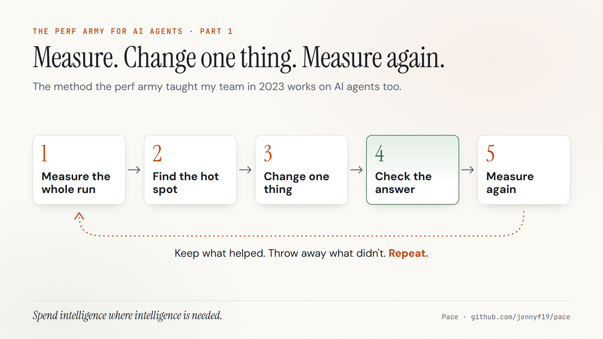
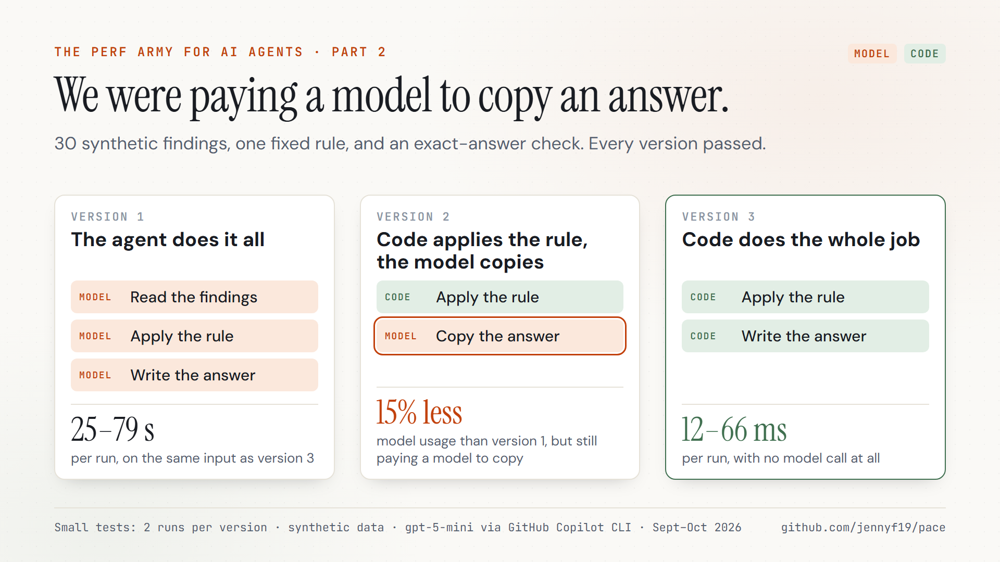
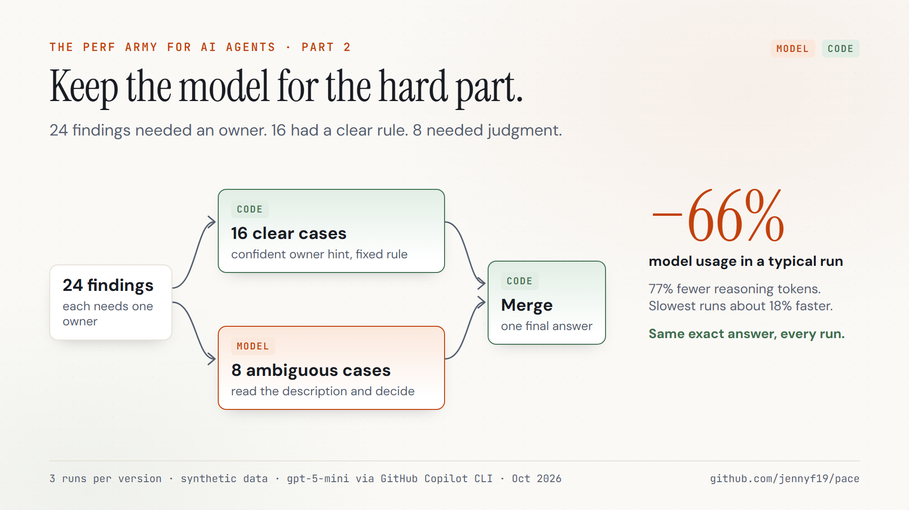

# Pace

> Measure the whole agent run. Move fixed-rule work into code. Keep the model
> for real judgment. Nothing counts as a win unless the answer is still right.

**Open source · [github.com/jennyf19/pace](https://github.com/jennyf19/pace)**  
Node.js 22 or later, no package dependencies. Reads GitHub Copilot CLI session
logs and direct model calls, then writes JSON receipts and readable reports.

---

## The question

Most teams can tell you whether their agent works. Few can tell you what one
run costs, how long it takes, or where that time goes.

When people do look, they usually look at the model: the prompt, the model
choice, the reasoning setting. But an agent run is a whole system:
instructions, tools, files, retries, other agents, validation, and output. The
expensive part is often somewhere else.

Pace starts with a simpler question:

**Where is this run spending intelligence, and where is it just moving an
answer around?**

## The method



It is the same method performance engineers have always used:

1. Measure the whole run.
2. Find the hot spot.
3. Change one thing.
4. Check that the answer is still right.
5. Measure again. Keep what helped. Throw away what didn't.

Pace makes step 4 non-negotiable. A comparison returns `keep` only when the
quality check passes, the accounting is complete for the metrics you chose,
and the change measurably helped. Missing data is `unproven`, never zero. A
quality regression is `reject`.

## What we found



In one small test, we moved a fixed filtering rule into code and saw model
usage drop about 15%. Then we noticed the model's remaining job was copying an
answer code had already produced. Removing the model entirely took runs from
25–79 seconds with the agent to 12–66 milliseconds with code, with the same
exact answer.



The more useful lesson came from a mixed job. Code handled the 16 cases with a
clear rule. The model handled only the 8 that needed judgment. Model usage fell
about two-thirds in a typical run, and every run still produced the exact
expected answer.

**Spend intelligence where intelligence is needed.**

These are small tests on synthetic data with one model (gpt-5-mini through
GitHub Copilot CLI, September–October 2026). Every receipt, including inputs,
settings, the evaluator, and raw measurements, is in the repository.

## Get it

```powershell
git clone https://github.com/jennyf19/pace
cd pace
node .\examples\frozen-comparison\run-example.mjs --out .\pace-output\frozen-comparison
```

That first run uses bundled synthetic data and makes no model calls. Then
profile one of your own Copilot CLI sessions:

```powershell
node .\profile-session.mjs "$HOME\.copilot\session-state\<session-id>" --out .\pace-output
```

Profiles leave out prompts, messages, code, and tool inputs by default.

## What this is not

- Not an agent framework or a hosted service
- Not a leaderboard
- Not a claim that code should replace models; only fully specified work moves
  to code
- Not statistics: results are descriptive receipts from small runs, not
  significance tests

## See also

- [**Sealed Delegation**](../sealed-delegation/) — hand a local model one
  bounded job, with an independent check
- [**Agent Signals**](../agent-signals/) — the feedback loop agents emit after
  real work
- [**GitHub repo**](https://github.com/jennyf19/pace) — profilers, comparison
  receipts, examples, and the accounting rules
